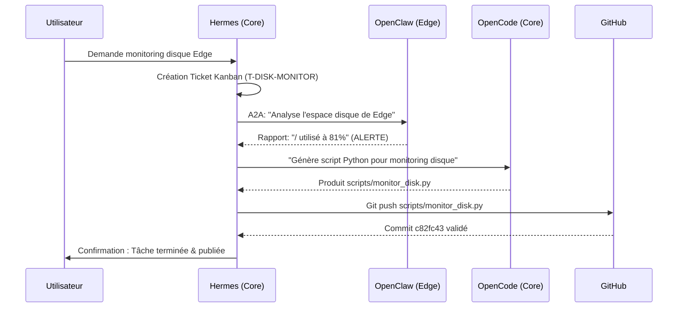

# Workflow Proof: Automated Disk Monitoring (T-DISK-MONITOR)

Ce document prouve la capacité d'orchestration distribuée du lab TwisterLab en combinant **Hermes**, **OpenClaw** et **OpenCode**.

## 🎯 Objectif
Automatiser la détection d'un espace disque critique sur le nœud Edge et produire un script de monitoring validé et versionné sur GitHub.

## 🔄 Flux d'exécution (Sequence)



## 🛠️ Preuves d'exécution (Logs réels)

### 1. Analyse via OpenClaw (Edge)
**Commande :** `hermes peer dm edge "OpenClaw: Analyse l'espace disque..."`
**Résultat :**
> Disque racine : `/`
> - Taille : 246G
> - Utilisé : 189G (81%)
> - Disponible : 46G
> **Pourcentage d'utilisation : 81%**

### 2. Génération via OpenCode (Core)
**Action :** Création du fichier `scripts/monitor_disk.py`
**Code produit :**
```python
import shutil

def check_disk_usage():
    """Monitoring script for Edge node."""
    path = "/"
    total, used, free = shutil.disk_usage(path)
    percent_used = (used / total) * 100
    if percent_used > 80:
        print("WARNING: Disk usage is above 80%!")
```

### 3. Publication GitHub
**Commande :** `git push origin main`
**Résultat :** `[main c82fc43] feat: add disk monitoring script for Edge`

---

## 📈 Conclusion technique
Ce workflow démontre que :
1. **L'orchestration A2A** fonctionne entre Core et Edge.
2. **OpenClaw** peut extraire des métriques système en temps réel.
3. **OpenCode** peut transformer un besoin métier en code fonctionnel.
4. **Le cycle de vie complet** (Kanban $\rightarrow$ Analyse $\rightarrow$ Code $\rightarrow$ Git) est automatisé.
